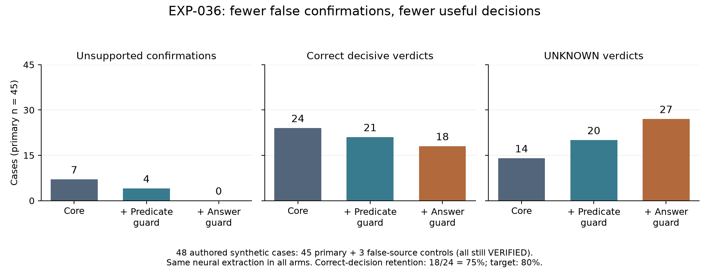

# EXP-036: Prospective Synthetic Transfer Results

**Completed:** 2026-11-17. One 48-call local inference run, no retries or repairs.
Protocol/data/analysis freeze: commit `96cc9e9`, tag `exp036-freeze-2026-11-17`.

## Main finding and hypothesis outcome

The combined guards blocked all seven oracle-relative false confirmations
observed in the primary set but also rejected six correct decisive core
verdicts. Correct-decision retention was 18/24 = 75%, below the predeclared
80% target. The joint feasibility hypothesis did NOT pass. This is a failure
of the stated engineering screen, not a population-level hypothesis rejection.

The false-confirmation reduction target was met (7 to 0, a 100% relative
reduction within these cases). It is insufficient on its own: the guards can
only keep a verdict or return UNKNOWN, so nonincrease is structural. The
predeclared coverage/utility condition prevents accepting an abstain-everywhere
system as successful. Thresholds were not changed after viewing results.

## Paired measured outcomes

All three arms share each model extraction. Primary n = 45; three false-source
controls are reported separately as specified before inference.

| Outcome | Core | + Predicate guard | + Answer guard (combined) |
|---|---:|---:|---:|
| Incorrect VERIFIED relative to authored oracle | 7 | 4 | 0 |
| Total VERIFIED | 22 | 16 | 9 |
| Correct decisive verdicts | 24 | 21 | 18 |
| All decisive verdicts | 31 | 25 | 18 |
| UNKNOWN | 14 | 20 | 27 |
| Agreement with authored expected verdict | 38 | 38 | 39 |

The combined method's false-confirmation/all-case rate fell from 15.56% to 0%.
Correct-decisive/all-case rate fell from 53.33% to 40.00%; overall decisive
coverage fell from 68.89% to 40.00%. Oracle agreement rose only from 38/45 to
39/45. None of these is a measured hallucination rate for generated answers.

## Case-level explanation

- Predicate checks blocked three location-as-winner false confirmations,
  T11_1–T11_3. They also lost three correctly extracted document paraphrases,
  T05_1–T05_3, under G2_FACT_RELATION.
- The answer guard blocked four more false confirmations: incompatible winners
  in T06_1/T06_3, self-negation in T07_1, and mixed refusal/assertion in T08_2.
  It also lost three correctly extracted answer paraphrases, T04_1–T04_3,
  under G3_UNSUPPORTED_ANSWER.
- All three rejected-alternative controls T03_1–T03_3 remained VERIFIED. This
  includes rejected quotations and an explicit contrast; it does not establish
  handling of arbitrary quotation syntax.
- Six utility losses came from the guard grammar, not failed extraction: all
  six had exact oracle-matching typed extractions. Examples include "The winner
  was Copper Badgers" and "Jade Panthers took first place."
- T16_1–T16_3 all remained VERIFIED against deliberately false-but-consistent
  sources, despite contradicting the authored external truth. They are not
  counted as oracle-relative errors because that oracle tests source consistency.
  The zero in the primary error column does not mean factual truth is certified.

## Extraction and uncertainty

Across all 48 calls, 46/48 passed strict validation and 33/48 matched the exact
semantic extraction signature. Two outputs used invalid null values: T08_3
had SINGLE_CLAIM with a null answer value; T10_1 had a null fact value. The
remaining 13 mismatches were schema-valid semantic/state errors:

- Seven caused the false confirmations listed above.
- Five cases (T09_1–T09_3, T10_2–T10_3) mislabeled an affirmative response as
  abstention or unresolved while correctly returning no positive source fact.
- T15_2 preserved the earlier source year but marked that document UNRESOLVED.

These latter six mismatches still produced the expected UNKNOWN. Thus verdict
agreement alone would hide extraction defects. The guards do not repair them.

The predeclared 2,000 paired family-bootstrap resamples (seed 36017, 15 primary
families) gave exploratory 95% percentile ranges:

| Measure | Point estimate | Family-bootstrap range |
|---|---:|---:|
| False-confirmation rate reduction | 15.56 percentage points | 2.22 to 31.11 pp |
| Correct-decision retention | 75.00% | 40.00% to 100.00% |
| Correct-decisive rate change | -13.33 percentage points | -33.33 to 0.00 pp |

All 2,000 retention replicates were defined. These are sensitivity intervals
over an authored family mixture, not population confidence guarantees. The
48 rows are not independent natural samples; no row-level significance test
or powered effectiveness claim is made. Cases include new entities and wording
but reuse known failure mechanisms. The fixture author also designed the guards.

## Reproducibility and cost

The run used the frozen Mistral 7B 4-bit revision and prompt with greedy
sampling, 48 local calls, and a 1,024-token maximum per call. No paid API or new
model download was used. The maximum permitted output was 49,152 tokens;
actual generated token counts were not measured and must not be inferred from
that bound. Extraction time: mean 4.768 s, median 4.752 s, nearest-rank p95
6.223 s. These exclude model loading and do not measure end-to-end efficiency.

- Raw: `results/raw/exp036_prospective_transfer.jsonl`
- Manifest: `results/raw/exp036_prospective_transfer_manifest.json`
- Summary: `results/processed/exp036_prospective_transfer_summary.json`
- Raw SHA-256: `c29626c08e9a8c2dad8b8096db5403e6ec0d44160c62bfbd960e9d042012f253`
- Figure script: `experiments/exp036_plot_transfer.py` (post-run visualization)

All 57 software tests passed before inference. Post-run checks reproduced every
saved prompt, extraction interpretation, guard decision, and processed summary
from the original 48 raw strings and verified the entire frozen source chain.
Historical results, model output, method, fixtures, and thresholds are unchanged.

## Defensible thesis statement and next work

"On a prospectively fixed synthetic stress set, deterministic scope and
answer-consistency guards blocked seven unsupported confirmations but also
abstained on six correctly parsed paraphrases. The observed 75% retention of
correct decisions failed the predeclared 80% utility target, illustrating a
reliability–coverage tradeoff rather than general hallucination reduction."

Do not add these six paraphrases to the grammar and reuse EXP-036 as a fresh
validation set. Preserve this result. If a later variant is justified, use a
new EXP identifier and a separately fixed evaluation set. Before more prompt
or grammar tuning, complete independent semantic annotation of EXP-029 through
EXP-031 and define the new verifier's actual answer/abstention policy for a
measured demonstrator. That establishes relevant factual-error evidence and
clarifies how restricted-domain verification could be useful. A full RAG
comparison remains necessary to support the broad thesis claim.
